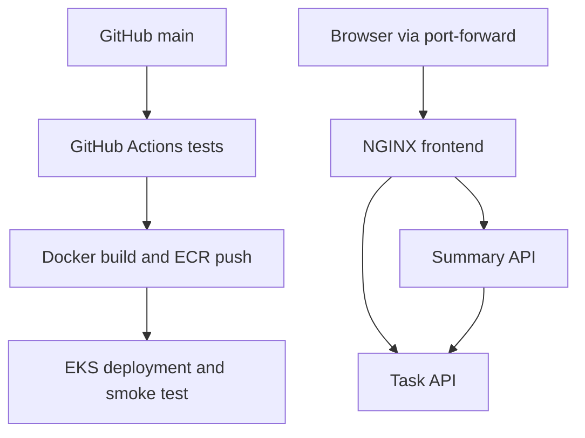

# ShipStack — Microservices CI/CD on AWS EKS

A portfolio lab: a task dashboard, a task API and a summary API. A push to `main`
can test the app, build commit-tagged images, publish to Amazon ECR, deploy to EKS,
wait for readiness, and smoke-test the deployed services.

**Status:** application integration tests are included. AWS infrastructure and the
container/Kubernetes pipeline must be verified in your own account before claiming
an end-to-end deployment. Read `VALIDATION.md` for the build-session results.

## Architecture



Terraform provisions the VPC, two subnets, EKS control plane, managed nodes, ECR,
CloudWatch control-plane logs and a repository/environment-scoped GitHub OIDC role.
The application runs inside the `launchpad` namespace. No AWS access keys belong
in this repository or GitHub secrets.

## Quick start without Docker

In Ubuntu WSL with Python 3.12+, run:

```bash
python3 scripts/dev.py
```

Open **http://localhost:8080**. This starts both APIs and a development proxy on
localhost. Press Ctrl+C to stop. Docker and Kubernetes use NGINX instead of this
development proxy. Ports 8000, 8001 and 8080 must be free.

## 1. Run locally with Docker

Requirements: Docker Engine or Docker Desktop with WSL integration and Compose v2.
From the extracted project folder in Ubuntu:

```bash
docker compose up --build -d --wait
```

Open **http://localhost:8080**. Add a task, mark it complete and refresh the page.
Then verify the full route through NGINX:

```bash
python3 scripts/smoke.py http://localhost:8080
docker compose logs --tail=50
```

Stop with `docker compose down`. Task data is temporary and resets on task-process
restart. The smoke test leaves one completed task as evidence.

## 2. Run tests without Docker or AWS

Only Python 3.12+ is required. The APIs use the Python standard library rather than
FastAPI, keeping this beginner lab dependency-free and easy to inspect.

```bash
python3 -m unittest discover -s tests -v
```

Tests start real HTTP servers on temporary ports and cover task creation, listing,
completion, summary aggregation, invalid requests and an unavailable upstream.

## 3. Try local Kubernetes (optional, free of AWS charges)

Install kind and kubectl using their official documentation. Create a kind cluster,
build local images and load them before applying the manifests:

```bash
kind create cluster --name launchpad
for service in tasks summary frontend; do
  docker build -t "launchpad-$service:local" "services/$service"
  kind load docker-image "launchpad-$service:local" --name launchpad
done
kubectl apply -f k8s/base.yaml
for service in tasks summary frontend; do
  kubectl -n launchpad rollout status "deployment/$service" --timeout=180s
done
kubectl -n launchpad port-forward svc/frontend 8080:8080
```

Keep port-forward running, then open localhost:8080. From another terminal run the
smoke test. Clean up with `kind delete cluster --name launchpad`.

## 4. Prepare GitHub

Create a repository named `shipstack-eks`, then push the extracted contents:

```bash
git init -b main
git add .
git commit -m "Build microservices deployment lab"
git remote add origin https://github.com/Reah3267/shipstack-eks.git
git push -u origin main
```

The CI workflow runs immediately. Deployment skips until repository variables are
configured. In Settings → Environments create **production**, and restrict its
allowed deployment branches to **main**. The IAM trust uses the environment subject;
GitHub's environment branch restriction is therefore a required security setting.
Avoid a required-review gate if you want automatic deployments on main.

## 5. Provision AWS (paid stage)

Requirements: an AWS account, an IAM/SSO identity allowed to provision these
resources, AWS CLI v2, Terraform 1.6+ and kubectl matching the EKS minor version.
Use `aws configure sso` / `aws sso login` where available. Confirm the correct
account using `aws sts get-caller-identity`. Do not use root credentials.

**Cost:** EKS standard-support control plane is $0.10/hour, plus two t3.medium
nodes, EBS volumes, public IPv4, logs and ECR. Region pricing varies. This lab is
not free. Set an AWS Budget alert before applying; an alert does not cap spending.
Do not leave the cluster running between practice sessions.

```bash
cd infra
cp terraform.tfvars.example terraform.tfvars
```

Edit `github_repository` to your exact OWNER/REPO. Kubernetes 1.35 is the starting
version; verify its standard-support window and regional availability before apply.
If your AWS account already has the GitHub OIDC provider, set its existing ARN in
`github_oidc_provider_arn` rather than attempting to create a duplicate.

```bash
terraform init
terraform fmt -check
terraform validate
terraform plan -out=lab.tfplan
terraform apply lab.tfplan
terraform output
```

Creating EKS typically takes several minutes. Terraform state is local in this
single-user lab: keep it private and retain it for cleanup. For team use, configure
an encrypted remote backend with locking before applying. A provider lock file is included. Retain and commit it; never commit tfstate, plans or tfvars.

As the same AWS identity that created the cluster, bootstrap the namespace:

```bash
aws eks update-kubeconfig --region ap-south-1 --name launchpad-eks
kubectl create namespace launchpad --dry-run=client -o yaml | kubectl apply -f -
```

The deploy role can edit resources only in this namespace and cannot create it.

## 6. Enable automatic deployment

Set these **repository Actions variables** under Settings → Secrets and variables
→ Actions → Variables (copy Terraform outputs):

| Variable | Value |
|---|---|
| AWS_ROLE_ARN | `github_role_arn` output |
| AWS_REGION | `region` output, normally `ap-south-1` |
| EKS_CLUSTER_NAME | `cluster_name` output |

Push a new commit on main, or run **Build and deploy to EKS** with Run workflow.
This pipeline executes its own tests before assuming the AWS role. It builds all
three images, tags them with the commit SHA, pushes them to immutable ECR repos,
applies deployments and waits for rollouts. A temporary port-forward then checks
HTTP creation, completion and service-to-service aggregation through NGINX.

To view the AWS app locally:

```bash
kubectl -n launchpad port-forward svc/frontend 8080:8080
```

There is deliberately no public load balancer or public application URL in this
lab. Only your local port-forward exposes the UI. A public release needs TLS,
authentication and an ingress/load-balancer design.

## 7. Demonstrate deployment, scaling and recovery

1. Change the frontend heading and push to main. Record the workflow result and
   `kubectl -n launchpad get pods` plus `kubectl -n launchpad get deploy -o wide`.
2. Scale the stateless summary service:
   `kubectl -n launchpad scale deployment summary --replicas=3`.
3. Delete one summary pod using its exact name. Watch Kubernetes replace it with
   `kubectl -n launchpad get pods -w`. This proves replica recovery, not load capacity.
4. Inspect revisions with `kubectl -n launchpad rollout history deployment/frontend`.
5. After a second successful release, roll back the frontend with
   `kubectl -n launchpad rollout undo deployment/frontend`, then wait for rollout.
6. Run the smoke test again. A later pipeline deployment reapplies the current Git
   version and the declared replica counts.

Failure of rollout or smoke tests fails the workflow and prints diagnostics.
There is no automatic coordinated rollback across all three services: inspect the
failing release, roll back affected deployments or fix forward. Never treat a
failed run as a confirmed deployment.

## Design limits and next improvements

- Tasks are held in memory in **one replica**. Recreate deployment avoids two task
  stores serving contradictory data; it introduces brief downtime and resets data
  during task releases. Do not scale tasks until you replace this with a shared DB.
- Frontend and summary have two replicas, health checks, resource requests/limits,
  non-root containers and rolling updates. No HPA or cluster autoscaler is installed.
  Node-group min/max settings are bounds, not automatic workload-driven scaling.
- Public subnets avoid a NAT gateway for a short lab. Nodes have public IPs but no
  application NodePort or SSH ingress is configured. Production should use private
  nodes, a private API endpoint, private runners and explicit network policies.
- The Kubernetes API is reachable publicly to support GitHub-hosted runners; IAM
  authentication and namespace authorization still apply. Do not confuse a public
  API endpoint with anonymous application access.
- APIs are small standard-library demo servers with no user authentication. This
  is a learning project, not a production task platform. No benchmark has been run.
- Base images/actions use version tags; for hardened supply-chain reproducibility,
  review and pin image digests and action commit SHAs, then add automated updates.
- ECR scans images, but scanning results do not currently block releases.
- Next improvements: managed PostgreSQL + migrations, TLS ingress, application
  metrics, HPA with metrics-server, network policies, image-scan gates and alerts.

## 8. Cleanup — stop AWS charges

Save any desired screenshots/log evidence. Then, as cluster admin:

```bash
kubectl delete namespace launchpad --wait=true
cd infra
terraform plan -destroy -out=destroy.tfplan
terraform apply destroy.tfplan
```

This destroys this lab's EKS, nodes, VPC, ECR repos **including their images**, logs
and any OIDC provider created by this configuration. A reused OIDC provider is not
destroyed. Check AWS console for remaining EKS clusters, EC2 instances, volumes,
network interfaces, load balancers, public IPs and ECR repositories. If you added
other resources manually, delete them too. Disabling Actions does not remove AWS
resources. Keep Terraform state until cleanup succeeds.

## Troubleshooting

| Symptom | Check |
|---|---|
| Docker unavailable in WSL | Start Docker Desktop and enable integration for Ubuntu |
| Port 8080 busy | Stop the other process or use a different host port |
| OIDC role rejected | Exact OWNER/REPO, environment production, main branch and provider audience |
| Namespace forbidden | Bootstrap namespace as cluster creator; CI has namespace-only rights |
| Nodes do not join | IAM attachments, subnet public IPs, routes, quotas and EKS events |
| ImagePullBackOff | Image exists with exact commit SHA; ECR node IAM permissions |
| Summary 503 | Task pod readiness and `kubectl -n launchpad logs deployment/tasks` |
| Terraform OIDC already exists | Supply the existing provider ARN in tfvars |
| Rollout stalls | `kubectl -n launchpad describe pod POD_NAME` and container logs |

## Official references

- https://aws.amazon.com/eks/pricing/
- https://docs.aws.amazon.com/eks/latest/userguide/kubernetes-versions.html
- https://docs.github.com/en/actions/how-tos/secure-your-work/security-harden-deployments/oidc-in-aws
- https://registry.terraform.io/providers/hashicorp/aws/latest/docs/resources/eks_cluster
- https://docs.aws.amazon.com/eks/latest/userguide/access-policy-permissions.html
- https://kind.sigs.k8s.io/docs/user/quick-start/
- https://docs.docker.com/compose/
