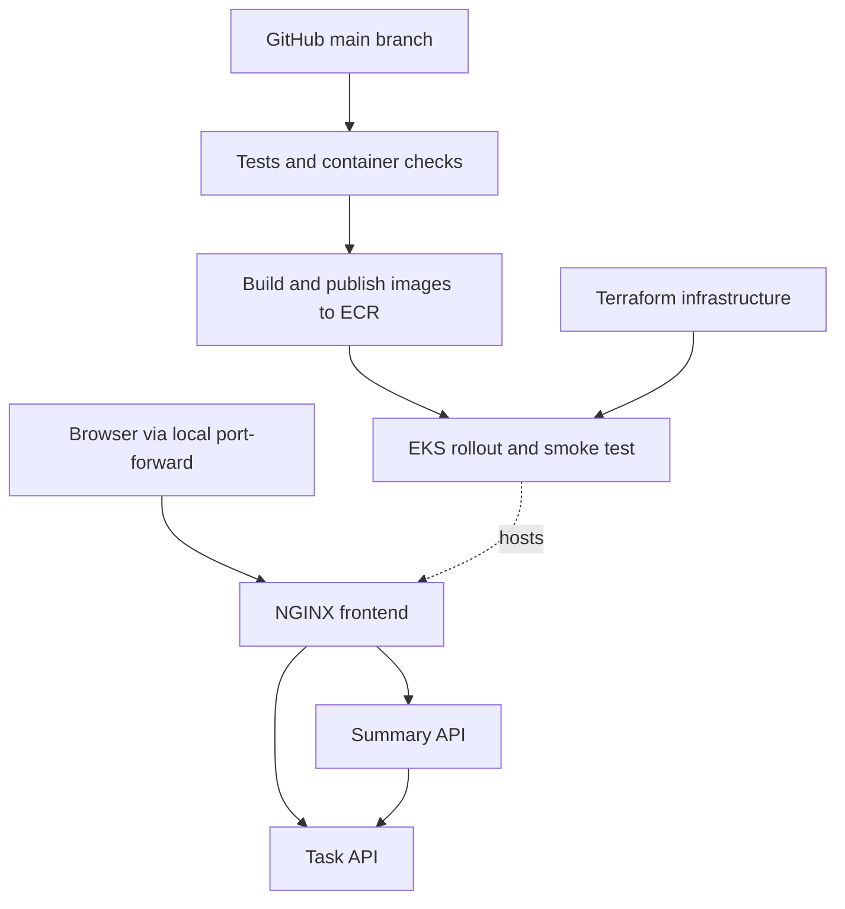

# ShipStack

### Microservices automation and deployment on AWS EKS

[](https://github.com/Reah3267/shipstack-eks/actions/workflows/ci.yaml)

**From a GitHub commit to a Kubernetes release.** ShipStack is a hands-on DevOps project that brings together microservices, containers, infrastructure as code, and CI/CD. A task-tracking application provides a practical workload for learning how each part of a deployment system fits together.

The repository includes a runnable application and configuration for testing changes, building Docker images, publishing to Amazon ECR, and deploying to Amazon EKS.

[Quick start](#quick-start) · [Architecture](#architecture) · [AWS deployment](#deploy-to-aws-eks) · [Validation](VALIDATION.md) · [Cleanup](#cleanup)

## Project status

| Area | Current status |
| --- | --- |
| Application | Built: frontend, Task API, and Summary API |
| Local verification | Eight HTTP integration tests and the development-proxy smoke test passed |
| Docker and Kubernetes | Configuration included; runtime verification pending |
| Terraform | Formatting checked; provider validation was blocked by a checksum mismatch in the build environment |
| GitHub Actions | CI and deployment workflows committed; successful workflow execution is not yet confirmed |
| AWS deployment | Pending account configuration and end-to-end verification |

See [VALIDATION.md](VALIDATION.md) for the verification record. Task data is currently held in memory and resets when the Task API restarts.

## What the project covers

- **Microservices:** separate task-management and summary APIs, with HTTP communication between services.
- **Containers:** individual Dockerfiles and a Docker Compose setup for running the application locally.
- **Kubernetes:** Deployments, internal Services, readiness and liveness probes, resource limits, and non-root containers.
- **Infrastructure as code:** Terraform configuration for networking, EKS, managed nodes, ECR, IAM, and control-plane logs.
- **CI/CD:** test execution, image builds, commit-SHA image tags, rollout checks, and deployment smoke tests.
- **AWS authentication:** GitHub OIDC with a repository/environment-scoped IAM trust policy and namespace-scoped EKS deployment access.
- **Operations:** troubleshooting, manual scaling, rollout inspection, rollback, and resource cleanup.

## Architecture



| Component | Responsibility | Technology |
| --- | --- | --- |
| Frontend | Display tasks, create tasks, and mark them complete; proxy API requests | HTML, CSS, JavaScript, NGINX |
| Task API | Validate, create, list, and update tasks | Python standard library |
| Summary API | Retrieve task data and calculate total, completed, and pending counts | Python standard library |
| Delivery pipeline | Test, build, publish, deploy, and verify | GitHub Actions, Docker, ECR, kubectl |
| Infrastructure | Provision the AWS environment and deployment identity | Terraform, AWS EKS, IAM, VPC, CloudWatch |

The Python-only development runner uses a lightweight proxy. Container and Kubernetes deployments use NGINX. Application Services are internal; the default configuration exposes the UI through a local port-forward rather than a public load balancer.

> **Naming:** the project is called ShipStack. Infrastructure identifiers retain the original `launchpad` prefix: namespace `launchpad`, default cluster `launchpad-eks`, and image repositories `launchpad-tasks`, `launchpad-summary`, and `launchpad-frontend`.

## Repository structure

```text
.github/workflows/ci.yaml       Application tests and Compose smoke test
.github/workflows/deploy.yaml   ECR publishing and EKS deployment workflow
services/frontend/             Dashboard, NGINX configuration, and Dockerfile
services/tasks/                Task API and Dockerfile
services/summary/              Summary API and Dockerfile
infra/                         Terraform resources, variables, and provider lock file
k8s/base.yaml                  Namespace, Deployments, and Services
scripts/dev.py                 Python-only local runner
scripts/render.py              ECR image-reference rendering
scripts/deploy.sh              Kubernetes deployment and rollout checks
scripts/smoke.py               HTTP smoke test
tests/test_services.py         HTTP integration tests
compose.yaml                   Local container setup
VALIDATION.md                  Verification results and remaining checks
```

## Quick start

### Option 1 — Python only

Requires **Python 3.12+**. No third-party Python packages or AWS account are needed.

```bash
git clone https://github.com/Reah3267/shipstack-eks.git
cd shipstack-eks
python3 scripts/dev.py
```

Open **http://localhost:8080**. Add a task and mark it complete to update the summary cards. Press **Ctrl+C** to stop.

Ports `8000`, `8001`, and `8080` must be available. If you already downloaded the project, run the command from its extracted root folder instead of cloning again.

### Option 2 — Docker Compose

Requires Docker Engine or Docker Desktop with **Compose v2**. On Windows, enable Docker Desktop integration for your Ubuntu WSL distribution.

From the project root:

```bash
docker compose up --build -d --wait
```

Open **http://localhost:8080**, then verify the application:

```bash
python3 scripts/smoke.py http://localhost:8080
docker compose logs --tail=50
```

Stop the containers with:

```bash
docker compose down
```

## Tests and API endpoints

Run the integration tests from the project root:

```bash
python3 -m unittest discover -s tests -v
```

The tests start real HTTP servers and cover task creation, listing, completion, summary totals, invalid requests, health checks, missing tasks, and an unavailable upstream service.

With the application running, execute the smoke test from a second terminal:

```bash
python3 scripts/smoke.py http://localhost:8080
```

The smoke test creates a task, marks it complete, checks the task list, and verifies the summary. It leaves the completed test task in the application.

| Method | Frontend route | Purpose |
| --- | --- | --- |
| `GET` | `/api/tasks` | List tasks |
| `POST` | `/api/tasks` | Create a task with `{"title":"Deploy ShipStack"}` |
| `PATCH` | `/api/tasks/{id}` | Update completion with `{"completed":true}` |
| `GET` | `/api/summary` | Return total, completed, and pending counts |
| `GET` | `/healthz` | Frontend health check |

## Run on local Kubernetes

Requires Docker, [kind](https://kind.sigs.k8s.io/docs/user/quick-start/), and kubectl. From the project root:

```bash
kind create cluster --name launchpad

for service in tasks summary frontend; do
  docker build -t "launchpad-$service:local" "services/$service"
  kind load docker-image "launchpad-$service:local" --name launchpad
done

kubectl apply -f k8s/base.yaml

for service in tasks summary frontend; do
  kubectl -n launchpad rollout status "deployment/$service" --timeout=180s
done

kubectl -n launchpad port-forward svc/frontend 8080:8080
```

Keep the port-forward running and open **http://localhost:8080**. Stop any existing local runner or Compose frontend before using the same port.

## Deploy to AWS EKS

### 1. Prepare your account and tools

You need an AWS account, AWS CLI v2, Terraform **1.6+**, kubectl compatible with the cluster version, and an IAM/SSO identity authorized to provision the resources in `infra/`.

Confirm the account before provisioning:

```bash
aws sts get-caller-identity
```

Use an appropriate IAM/SSO identity rather than root credentials. Do not commit credentials, Terraform state, plans, or private variable files.

> **AWS charges apply.** The configuration creates an EKS control plane, two `t3.medium` worker nodes, storage, public IPv4 addresses, ECR repositories, and logs. Review [EKS pricing](https://aws.amazon.com/eks/pricing/) and regional resource pricing before applying. Budget alerts notify you; they do not stop charges.

### 2. Provision the infrastructure

Run these commands from the project root:

```bash
cp infra/terraform.tfvars.example infra/terraform.tfvars
```

Review the copied file. The defaults use `ap-south-1`, cluster `launchpad-eks`, Kubernetes `1.35`, and repository `Reah3267/shipstack-eks`. Verify the Kubernetes version's [regional availability and standard-support window](https://docs.aws.amazon.com/eks/latest/userguide/kubernetes-versions.html) before provisioning.

If your account already has the GitHub OIDC provider, set `github_oidc_provider_arn` to its existing ARN.

```bash
terraform -chdir=infra init
terraform -chdir=infra fmt -check
terraform -chdir=infra validate
terraform -chdir=infra plan -out=lab.tfplan
terraform -chdir=infra apply lab.tfplan
terraform -chdir=infra output
```

Investigate any checksum mismatch before continuing; do not disable provider verification. Retain the included provider lock file. This single-user lab uses local Terraform state: keep it private and available for cleanup. Team use should configure an encrypted remote backend with locking before provisioning.

### 3. Bootstrap Kubernetes access

Using the same AWS identity that created the cluster:

```bash
export AWS_REGION="$(terraform -chdir=infra output -raw region)"
export EKS_CLUSTER_NAME="$(terraform -chdir=infra output -raw cluster_name)"

aws eks update-kubeconfig --region "$AWS_REGION" --name "$EKS_CLUSTER_NAME"
kubectl create namespace launchpad --dry-run=client -o yaml | kubectl apply -f -
```

The CI deployment role has edit access inside `launchpad`; it cannot create the namespace itself.

### 4. Configure GitHub Actions

In the repository settings:

1. Create an environment named **`production`**.
2. Restrict its deployment branches to **`main`**. This is required because the IAM trust policy identifies the repository and environment, while GitHub enforces the allowed branch.
3. Add the following **repository Actions variables** under **Settings → Secrets and variables → Actions → Variables**:

| Variable | Terraform output |
| --- | --- |
| `AWS_ROLE_ARN` | `github_role_arn` |
| `AWS_REGION` | `region` |
| `EKS_CLUSTER_NAME` | `cluster_name` |

AWS access keys are not required in GitHub secrets. The workflow requests temporary AWS credentials through OIDC.

Push a commit to `main`, or manually run **Build and deploy to EKS** from Actions. If you configure required environment reviewers, deployment waits for their approval.

### 5. Verify the release

The deployment workflow is configured to:

1. Run integration tests and a Docker Compose smoke test.
2. Assume the AWS deployment role through OIDC.
3. Build all three images and publish them to ECR with immutable commit-SHA tags.
4. Render Kubernetes image references, apply the manifests, and wait for healthy rollouts.
5. Smoke-test the deployed application through a temporary port-forward.

The separate CI workflow runs on pull requests and pushes to `main`. The deployment job skips until `AWS_ROLE_ARN` is configured.

To inspect and open the deployed application:

```bash
kubectl -n launchpad get pods
kubectl -n launchpad get deployments
kubectl -n launchpad port-forward svc/frontend 8080:8080
```

Open **http://localhost:8080**. A public application URL would require additional ingress, TLS, and authentication configuration.

## Operations practice

After completing and verifying a deployment, use these commands to explore Kubernetes behavior:

```bash
# Scale the stateless Summary API.
kubectl -n launchpad scale deployment summary --replicas=3

# Inspect frontend release history.
kubectl -n launchpad rollout history deployment/frontend

# After at least two successful revisions, restore the previous frontend revision.
kubectl -n launchpad rollout undo deployment/frontend
kubectl -n launchpad rollout status deployment/frontend --timeout=180s

# Inspect recent events and service logs.
kubectl -n launchpad get events --sort-by=.lastTimestamp
kubectl -n launchpad logs deployment/tasks --tail=50
```

A later deployment reapplies the replica counts and image version declared in Git. Failed rollout or smoke tests fail the workflow and trigger diagnostics. Rollback is manual; the workflow does not automatically coordinate rollback across multiple services.

## Current design limits

| Decision | Implication |
| --- | --- |
| In-memory task storage | Tasks disappear when the Task API restarts. Keep it at one replica until a shared database is added. |
| Task API uses `Recreate` deployment | Prevents independent task stores from serving simultaneously, with brief downtime during task releases. |
| Frontend and Summary API use two replicas | Supports manual scaling and rolling-update practice; no load-capacity claim has been measured. |
| No HPA or cluster autoscaler | Replica counts and node-group bounds do not provide automatic workload-driven scaling. |
| Public subnets and Kubernetes API endpoint | Simplifies a short lab and GitHub-hosted runner access. Production should use private nodes, private endpoint access, and suitable runners. |
| No application authentication or TLS ingress | Suitable for local/port-forward learning. Additional controls are needed before public exposure. |
| Image scanning enabled in ECR | Scan results do not currently block releases. Base images and Actions use version tags rather than digest/commit pins. |

The project demonstrates deployment concepts. It has not been benchmarked or validated as a production platform.

## Troubleshooting

| Issue | What to check |
| --- | --- |
| Docker is unavailable in WSL | Start Docker Desktop and enable integration for Ubuntu. |
| Port `8080` is already in use | Stop the other local runner, container, or port-forward. |
| OIDC role assumption fails | Check the exact repository, `production` environment, audience, and allowed deployment branch. |
| Namespace access is forbidden | Bootstrap `launchpad` as the cluster creator and inspect the deployment role's EKS access association. |
| Nodes do not join | Inspect IAM policies, subnet routing, public-IP assignment, AWS quotas, and cluster events. |
| `ImagePullBackOff` | Check the exact commit tag in ECR and the worker node's image-pull permissions. |
| Summary returns `503` | Check Task API health, internal service connectivity, and task-service logs. |
| OIDC provider already exists | Reuse its ARN through `github_oidc_provider_arn`. |
| Rollout stalls | Run `kubectl -n launchpad describe pod POD_NAME` and inspect container logs. |

## Cleanup

For local Docker:

```bash
docker compose down
```

For local kind:

```bash
kind delete cluster --name launchpad
```

For AWS, save any desired evidence, then run from the project root as a cluster administrator:

```bash
kubectl delete namespace launchpad --wait=true
terraform -chdir=infra plan -destroy -out=destroy.tfplan
terraform -chdir=infra apply destroy.tfplan
```

This removes the Terraform-managed lab infrastructure, including ECR images and control-plane logs. An OIDC provider created by this configuration is removed; a reused provider is retained. Check AWS for remaining resources and remove anything you added manually. Keep Terraform state until cleanup succeeds. Disabling GitHub Actions does not remove AWS resources.

## Roadmap

- [ ] Verify Docker, local Kubernetes, and GitHub Actions execution.
- [ ] Complete and record a successful AWS deployment and rollback demonstration.
- [ ] Add shared PostgreSQL storage and database migrations.
- [ ] Add TLS ingress and application authentication.
- [ ] Add application metrics, dashboards, and alerting.
- [ ] Configure autoscaling and test it under measured load.
- [ ] Add image-scan release gates and pin supply-chain dependencies.

## References

- [Amazon EKS documentation](https://docs.aws.amazon.com/eks/latest/userguide/what-is-eks.html)
- [GitHub Actions OIDC with AWS](https://docs.github.com/en/actions/how-tos/secure-your-work/security-harden-deployments/oidc-in-aws)
- [Terraform AWS EKS resource](https://registry.terraform.io/providers/hashicorp/aws/latest/docs/resources/eks_cluster)
- [EKS access policy permissions](https://docs.aws.amazon.com/eks/latest/userguide/access-policy-permissions.html)
- [Docker Compose documentation](https://docs.docker.com/compose/)
- [kind quick start](https://kind.sigs.k8s.io/docs/user/quick-start/)
